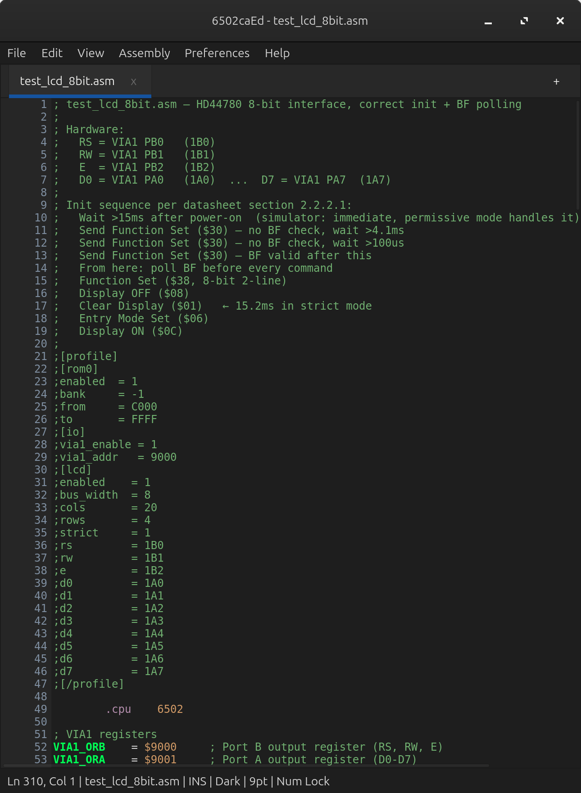
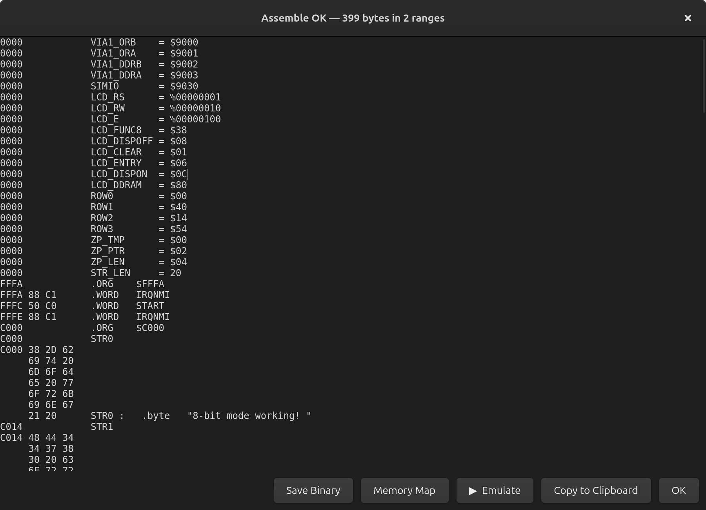
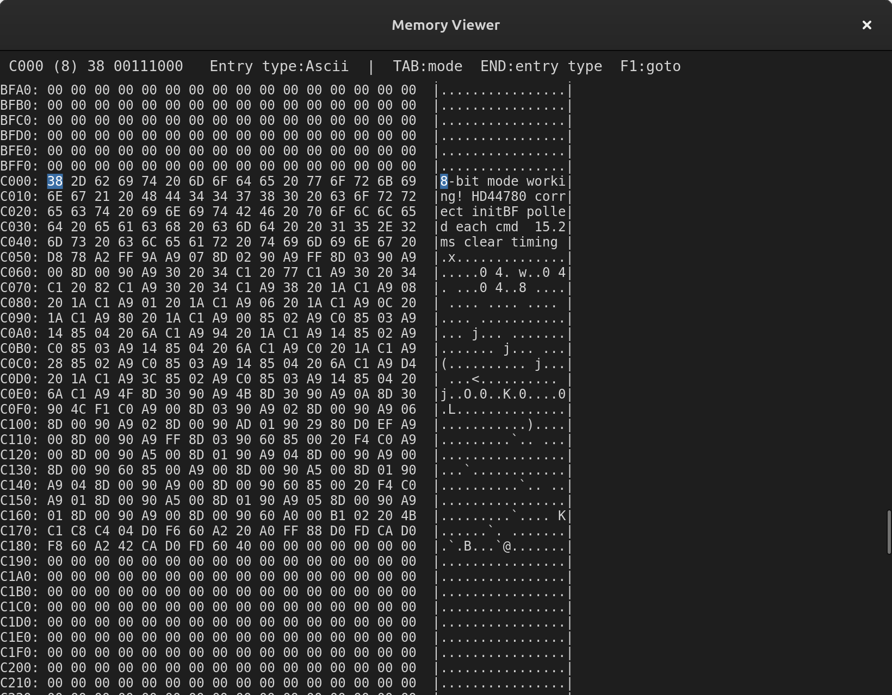
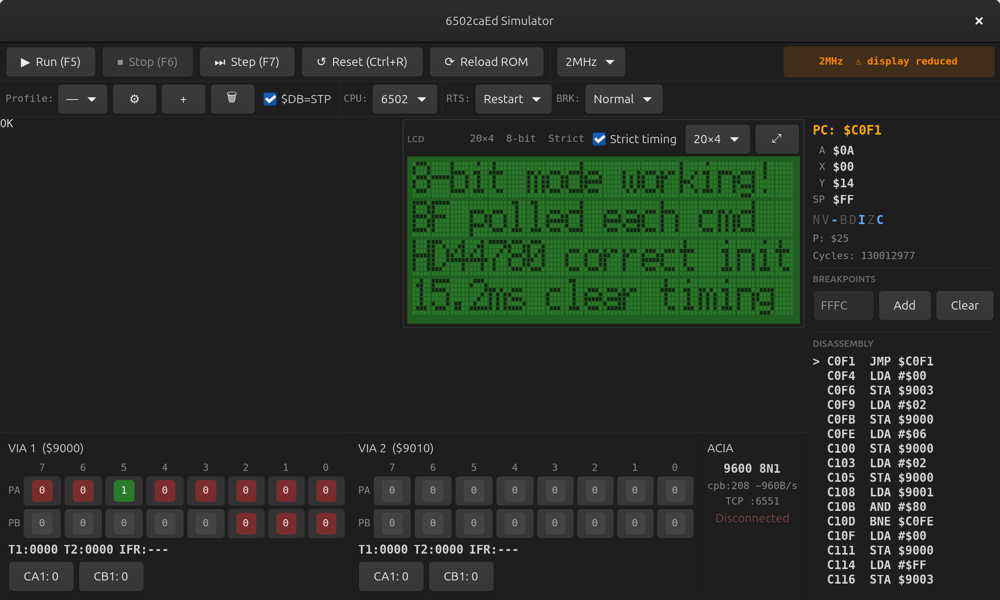

This is a project that I've been working on for sometime bust let'

# 6502caEd

A C11 assembly development suite for 6502, 65C02 and 65816 projects, combining a command-line assembler, terminal and GTK editors, and an integrated hardware simulator.

All three interfaces share the same assembler core. The GTK editor's optional simulator lets you run and debug programs against a configurable virtual machine, including two VIA devices, an ACIA serial interface, an HD44780 LCD and an SPI SD card.

## Status

This is an early project release. Bug reports and small, focused contributions are welcome. Processor support and simulator behaviour should be checked against your target hardware; the presence of an instruction or device model does not imply complete hardware compatibility.

The simulator supports banked memory configurations. The assembler supports 65816 instructions and 24-bit operands, while each assembled binary currently covers a selectable range within a **64KB image**.

## Screenshots

Click any screenshot to open it at full resolution.

### GTK editor

Source editing with syntax highlighting and embedded simulator profile settings.

<a href="6502caEd-Editor.png"></a>

### Assembly output

Assembly listing with generated bytes, symbols and controls for saving the binary, viewing memory and launching emulation.

<a href="6502caEd-Aseembly.png"></a>

### Memory viewer

Inspect assembled code and data in hexadecimal, binary and text form.

<a href="6502caEd-MemoryViewer.png"></a>

### Hardware simulator

An HD44780 LCD test running alongside VIA1, VIA2 and ACIA panels, CPU registers, breakpoints and disassembly.

<a href="6502caEd-Simulator.png"></a>

## Interfaces

| Executable | Description |
| --- | --- |
| `6502ca-cli` | Command-line assembler with binary, listing and symbol output |
| `6502caEd` | Terminal editor using ncurses on Linux or PDCurses on Windows |
| `6502caEdGtk` | Graphical editor using GTK 4 and GtkSourceView 5, with optional integrated simulator |

## Features

- 6502, 65C02 and 65816 instruction encoding, with optional undocumented 6502 opcodes.
- Labels, expressions, macros, includes and conditional assembly.
- Binary output, configurable assembly listings and symbol tables.
- Diagnostics with source locations and overwrite warnings.
- Syntax highlighting, code folding, find/replace and assembly diagnostics in the editors.
- Multiple tabs, an include manager and a memory viewer in the GTK editor.
- Integrated GTK simulator for testing assembly programs and peripheral interactions before moving to hardware.

See the [user manual](help/help.md) for the assembly language, editor features and simulator configuration.

## Integrated hardware simulator

Build the GTK editor with `ED_BUILD_SIM=ON` to assemble, run and debug programs inside the application. The simulator combines CPU emulation with configurable memory and peripheral models, making it useful for developing and testing software for a 6502-based computer.

### Devices and debugging

- **Two VIA devices (VIA1 and VIA2):** configurable I/O devices with port panels for inspecting peripheral interactions.
- **HD44780-compatible LCD:** test display routines with configurable VIA pin mappings, 4-bit or 8-bit transfers, and custom characters.
- **SPI SD card:** test SD-card communication through VIA-connected SPI signals.
- **ACIA serial interface:** test serial I/O, with a TCP connection for an external terminal.
- **Execution controls:** run, pause, single-step, reset and breakpoints, with register and disassembly views.
- **Machine profiles:** configure the memory map, device addresses and peripheral wiring; source comments can supply profile overrides.

Peripheral support is evolving, with more devices planned. See the [simulator manual](help/help.md#simulator) and [LCD/VIA guide](help/44780-lcd-via-guide/guide/44780_lcd_via.md) for configuration details and examples. Current limitations are listed below.

The term **simulator** describes the complete virtual hardware environment; **emulation** describes how its CPU and devices reproduce the behaviour of the real components.

## Build on Linux

Run these commands from the repository root, beside the top-level `CMakeLists.txt`.

Requirements are a C11 compiler and CMake 3.20 or newer. The terminal editor additionally needs curses; the graphical editor needs GTK 4, GtkSourceView 5 and pkg-config. Ninja is optional for the commands below.

### Command-line assembler only

On Debian or Ubuntu:

```sh
sudo apt update
sudo apt install build-essential cmake

cmake -S . -B build-cli \
  -DCMAKE_BUILD_TYPE=Release \
  -DED_BUILD_TUI=OFF \
  -DED_BUILD_GTK=OFF \
  -DED_BUILD_SIM=OFF
cmake --build build-cli --parallel
```

The executable is `build-cli/6502caEd/6502ca-cli`.

### Editors and simulator

On Debian or Ubuntu:

```sh
sudo apt install build-essential cmake pkg-config \
  libncurses-dev libgtk-4-dev libgtksourceview-5-dev

cmake -S . -B build \
  -DCMAKE_BUILD_TYPE=Release \
  -DED_BUILD_TUI=ON \
  -DED_BUILD_GTK=ON \
  -DED_BUILD_SIM=ON
cmake --build build --parallel
```

The executables are in `build/6502caEd/`:

```sh
./build/6502caEd/6502caEd program.asm
./build/6502caEd/6502caEdGtk
```

| CMake option | Default | Purpose |
| --- | --- | --- |
| `ED_BUILD_TUI` | `ON` | Build the terminal editor |
| `ED_BUILD_GTK` | `OFF` | Build the graphical editor |
| `ED_BUILD_SIM` | `OFF` | Include the simulator; requires `ED_BUILD_GTK=ON` |

The command-line assembler is always built. CMake presets are also supplied; their schema version 6 requires CMake 3.25 or newer and their builds use Ninja.

## Build on Windows

The repository includes an MSYS2 UCRT64/MinGW build workflow, a PowerShell build script and an optional Inno Setup packaging path. Follow the [Windows build guide](6502caEd_Windows_Build_Guide.md) for dependencies and setup.

From PowerShell in the repository root, after reviewing the script:

```powershell
powershell -ExecutionPolicy Bypass -File .\build_Windows.ps1 -Help
powershell -ExecutionPolicy Bypass -File .\build_Windows.ps1
```

## First program

Save this as `hello.asm`:

```asm
    .cpu 6502
    .org $0800

start:
    LDA #$01
    STA $00
    BRK
```

Assemble it using the CLI-only build:

```sh
./build-cli/6502caEd/6502ca-cli hello.asm -o hello.bin \
  --start '$0800' --end '$0804' \
  --listfile hello.lst --symfile hello.sym
```

This produces five bytes: `A9 01 85 00 00`. The output range is inclusive; without `--start` and `--end`, the CLI writes the full 65,536-byte image. The single quotes preserve the dollar signs in POSIX shells.

On first launch, the applications ask for licence acceptance. The CLI currently needs an interactive response before it can assemble a file or display version information.

### Useful CLI options

| Option | Purpose |
| --- | --- |
| `--cpu 6502`, `--cpu 65c02`, `--cpu 65816` | Select the processor |
| `--undoc` | Enable undocumented 6502 opcodes |
| `-I directory` | Add an include search directory; repeat as needed |
| `--start expression`, `--end expression` | Select the binary output range |
| `--listfile file.lst` | Write an assembly listing |
| `--nolist` | Suppress the listing on standard output |
| `--sym`, `--symfile file.sym` | Print or save symbols |
| `--symsort name`, `--symsort addr` | Choose symbol ordering |

**Current CLI workaround:** for 65816 programs, pass `--cpu 65816` explicitly, even when the source contains `.cpu 65816`. The current CLI does not apply that source directive to its CPU selection.

## Using the editors

Open or create an assembly file, then use the Assembly menu to check it or produce a binary. Common shortcuts include:

| Shortcut | Action |
| --- | --- |
| Ctrl+O | Open a file |
| Ctrl+S | Save |
| F5 | Check assembly |
| F9 | Assemble with binary output |
| F10 | Open the terminal editor's menu bar |

When simulator support is enabled, the GTK editor provides **Assembly → Assemble & Emulate**. Simulator-window controls have their own shortcuts. Use the menus as the reference if a shortcut differs from the manual.

## Documentation

- [User manual](help/help.md)
- [HTML user manual](help/help.html) — open locally in a browser
- [HD44780 LCD and VIA guide](help/44780-lcd-via-guide/guide/44780_lcd_via.md)
- [Windows build guide](6502caEd_Windows_Build_Guide.md)

The repository also includes `build_help.sh`, `build_Installers.sh` and `build_Windows.ps1` for documentation and packaging workflows.

## Source layout

| Directory | Contents |
| --- | --- |
| `6502caEd/core/` | Shared assembler, preprocessor, expressions, symbols and diagnostics |
| `6502caEd/cli/` | Command-line frontend |
| `6502caEd/editor/` | Terminal editor and shared editor utilities |
| `6502caEd/gui/` | GTK frontend |
| `6502caEd/sim/` | CPU, memory, peripherals and simulator interface |
| `help/` | Manual and hardware guides |

## Known limitations

- The CLI's `.cpu 65816` handling needs the explicit flag described above.
- The first-run CLI licence prompt prevents unattended use until acceptance has been recorded; declining or reaching end-of-input currently exits with status 0.
- 65816 simulation is incomplete; do not assume full native-mode or cycle-accurate behaviour.
- An included development note reports an LCD control problem when using VIA2. That issue has not been independently verified here.
- The source snapshot does not include an automated regression suite.

## Reporting problems and contributing

Please open a GitHub issue with your operating system, compiler and dependency versions, build options, expected behaviour and actual result. For assembler problems, include the smallest source file that reproduces the issue, the exact command and its output. For simulator problems, include the CPU type and profile settings.

Keep pull requests focused and include a reproducible example or test for behaviour changes.

## Licence

The supplied [licence notice](6502caEd/license-readme.txt) states **GNU GPL version 3 or, at your option, any later version**. See that notice for the warranty disclaimer and licence reference.
